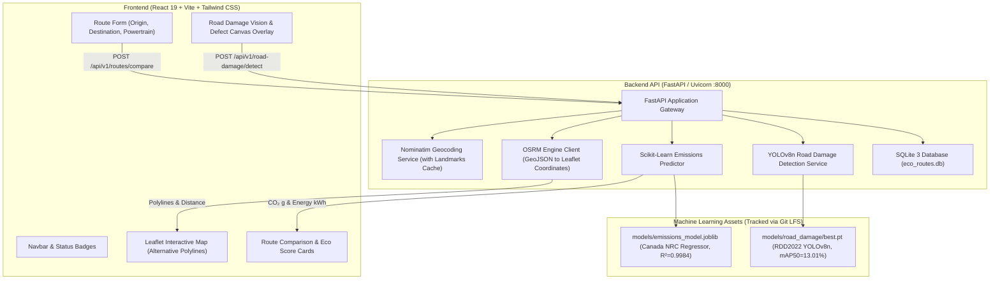

# Eco-Friendly Routes 🌿🚗

**Intelligent Multi-Route Green Navigation, Carbon Emissions Optimizer & Road Damage Vision**  
*College Problem-Based Learning (PBL) Capstone Project 2026*

[](https://fastapi.tiangolo.com)
[](https://react.dev)
[](https://vitejs.dev)
[](https://tailwindcss.com)
[](https://scikit-learn.org)
[](https://docs.ultralytics.com)
[](https://git-lfs.com)

---

## 📌 Project Overview

Traditional navigation engines strictly optimize for travel time or distance, overlooking tailpipe emissions, powertrain characteristics, and pavement quality.

**Eco-Friendly Routes** introduces an integrated environmental navigation platform:
1. **Candidate Route Discovery:** Evaluates multiple driving corridors between user-specified endpoints using the Open Source Routing Machine (OSRM) and OpenStreetMap road network.
2. **Certified Tailpipe Emissions Prediction:** Evaluates direct vehicle greenhouse gas emissions ($g\text{ CO}_2/\text{km}$) using a trained Scikit-Learn Random Forest Regressor ($R^2 = 0.9984$, $\text{MAE} = 3.82\text{ g/km}$).
3. **EV Energy Accounting:** Pure Electric Vehicles (EVs) are distinguished by reporting $0\text{ g}$ tailpipe $\text{CO}_2$ with energy consumption quantified separately in kilowatt-hours ($\text{kWh}$).
4. **Pavement Distress Inspection (Computer Vision):** Inspects road surface condition and detects potholes/cracks (D00, D10, D20, D40) using a trained Ultralytics YOLOv8n deep learning detector on the official RDD2022 India dataset.

---

## 🏗️ System Architecture



---

## 📊 Datasets & Verified Empirical Metrics

The repository is built strictly upon two verified datasets (unverified third-party sets such as BDD100K are intentionally excluded):

### 1. Natural Resources Canada — Vehicle Emissions Dataset
- **Scope:** 7,385 certified vehicle records across gasoline, diesel, hybrid, and ethanol powertrains.
- **Input Features:** Engine Size (L), Cylinders, Transmission Type, Fuel Type. (Zero target leakage; fuel consumption columns strictly excluded from predictors).
- **Held-Out Test Set Metrics ($n=1,477$):**
  - **$R^2$ Score:** `0.9984`
  - **Mean Absolute Error (MAE):** `3.82 g/km`
  - **Root Mean Squared Error (RMSE):** `5.64 g/km`

### 2. Official RDD2022 India Dataset (CRDDC 2022)
- **Scope:** Pavement camera survey images annotated for surface damage.
- **Architecture:** Ultralytics `YOLOv8n` (512x512, batch 8, CPU training, 5 epochs).
- **Held-Out Test Set Metrics (Official RDD2022 India Test Split):**
  - **mAP@0.5:** `13.01%` (Baseline: `3.12%`, **+317% relative improvement**)
  - **mAP@0.5:0.95:** `5.40%` (Baseline: `0.95%`)
  - **Precision:** `19.65%`, **Recall:** `16.39%`
  - **Class Breakdowns:**
    - `D20` (Alligator Crack): `14.01%` AP50
    - `D40` (Pothole): `5.29%` AP50
    - `D00` (Longitudinal Crack): `2.30%` AP50
    - `D10` (Transverse Crack): `0.00%` AP50 *(Documented academic disclosure: only 10 test annotation instances in the India test split)*.

---

## 💻 Prerequisites

Ensure your system has the following tools installed:

1. **Python 3.10+** (Tested and verified on Python 3.10, 3.11, 3.12, 3.14).
2. **Node.js 18+ or 20+** and `npm` (Node 20 LTS recommended).
3. **Git** and **Git LFS** ([https://git-lfs.com](https://git-lfs.com)).
   - Verify Git LFS is installed by running: `git lfs version`

---

## 🚀 Step-by-Step Installation Guide (For Another PC)

### Step 1: Clone the Repository with Git LFS

Open a terminal (PowerShell, Command Prompt, or bash) and clone the repository:

```bash
# 1. Clone the repository
git clone https://github.com/sovin4391/eco-friendly-routes.git

# 2. Enter the project root
cd eco-friendly-routes

# 3. Pull Git LFS model binaries (models/emissions_model.joblib, models/road_damage/best.pt)
git lfs pull
```

---

### Step 2: Set Up the Backend (FastAPI & Machine Learning)

1. Navigate to the `backend/` directory:
   ```bash
   cd backend
   ```

2. Create a virtual environment and activate it:
   - **Windows (PowerShell)**:
     ```powershell
     python -m venv .venv
     .\.venv\Scripts\Activate.ps1
     ```
   - **Windows (CMD)**:
     ```cmd
     python -m venv .venv
     .\.venv\Scripts\activate.bat
     ```
   - **Linux / macOS**:
     ```bash
     python3 -m venv .venv
     source .venv/bin/activate
     ```

3. Install required Python packages:
   ```bash
   # Core backend and tabular emissions ML dependencies
   pip install -r requirements.txt

   # Computer vision and YOLOv8 dependencies
   pip install -r requirements-cv.txt
   ```

4. Prepare environment configuration:
   ```bash
   # Copy template to .env (defaults work out of the box)
   cp .env.example .env
   ```

---

### Step 3: Set Up the Frontend (React & Tailwind CSS)

1. In a second terminal window, navigate to the `frontend/` directory:
   ```bash
   cd eco-friendly-routes/frontend
   ```

2. Install npm packages:
   ```bash
   npm install
   ```

---

## 🏃 Running the Application

### Terminal 1: Start the Backend Server

From the project root with the virtual environment activated:

```bash
python -m uvicorn backend.main:app --host 127.0.0.1 --port 8000
```

- **Health Check:** [http://127.0.0.1:8000/health](http://127.0.0.1:8000/health)
- **Interactive Swagger Docs:** [http://127.0.0.1:8000/docs](http://127.0.0.1:8000/docs)

### Terminal 2: Start the Frontend UI

From `frontend/`:

```bash
npm run dev
```

- **Web Dashboard:** [http://localhost:5173](http://localhost:5173)

---

## 🧪 Testing and Verification

To verify that all services, safeguards, and algorithms function properly:

```bash
# Run the complete test suite (77 tests covering ML, routing, geocoding, CV)
.\backend\.venv\Scripts\pytest tests/ -v
```

All 77 tests will run and pass:
- Dataset target leakage checks
- Zero-division guards for EV savings formulas
- Geocoding input validation & landmark hijacking prevention
- OSRM timeout & coordinate bounds safeguards
- Road damage detection and path-traversal protection

---

## 📦 Large Dataset Handling (RDD2022 India)

To comply with GitHub's file-size limits and preserve repository responsiveness, the heavy 502 MB RDD2022 zip archive and 32,000 raw training images are excluded from standard Git history.

- **Instant Demonstration:** 3 verified pavement test images (`India_000168.jpg`, `India_000174.jpg`, `India_000241.jpg`) and all metadata manifests are included directly in the repository. The web UI includes **1-Click Test Sample** buttons to run live detections immediately upon cloning.
- **Reproducing Full Dataset:** If you wish to re-train the road damage model from scratch:
  ```bash
  # 1. Automated resumable download of official RDD2022 India archive (502 MB) from Figshare
  python ml/download_rdd2022.py

  # 2. Automated Pascal VOC XML conversion to YOLO format
  python ml/preprocess_rdd2022.py

  # 3. Train YOLOv8n detector
  python ml/train_road_damage.py
  ```
- **Official Figshare Publication:** [RDD2022 Dataset Article](https://figshare.com/articles/dataset/RDD2022_-_The_multi-national_Road_Damage_Dataset_released_through_CRDDC_2022/21431547) (CC BY 4.0).

---

## ⚠️ Academic & Methodological Disclosures

1. **Routing Provider:** Driving paths and distances are sourced dynamically from the public Open Source Routing Machine (OSRM) service. The public demo server does not reflect real-time live traffic congestion or traffic signal wait delays.
2. **Emissions Methodology:** Tailpipe emissions represent certified direct tailpipe $\text{CO}_2$ ($\text{rate g/km} \times \text{distance km}$). Electric vehicles report $0\text{ g}$ direct tailpipe emissions; life-cycle manufacturing and electricity grid carbon intensity are excluded from tailpipe figures.
3. **Modular Computer Vision:** Detected road surface distress is reported strictly as local visual evidence. In accordance with safety principles, camera detections do not alter baseline route driving distances without verified geospatial survey telemetry.
4. **Preserved History:** An earlier project archive is preserved intact in `archive/questionbot/`.

---

## 👥 Contributors

- **Sovin K Shibu** — Sahrdaya College of Engineering and Technology (Team Lead)
- **Eco-Friendly Routes Project Team** (College PBL Capstone 2026)

---
*Developed for Problem-Based Learning (PBL) Capstone 2026.*
